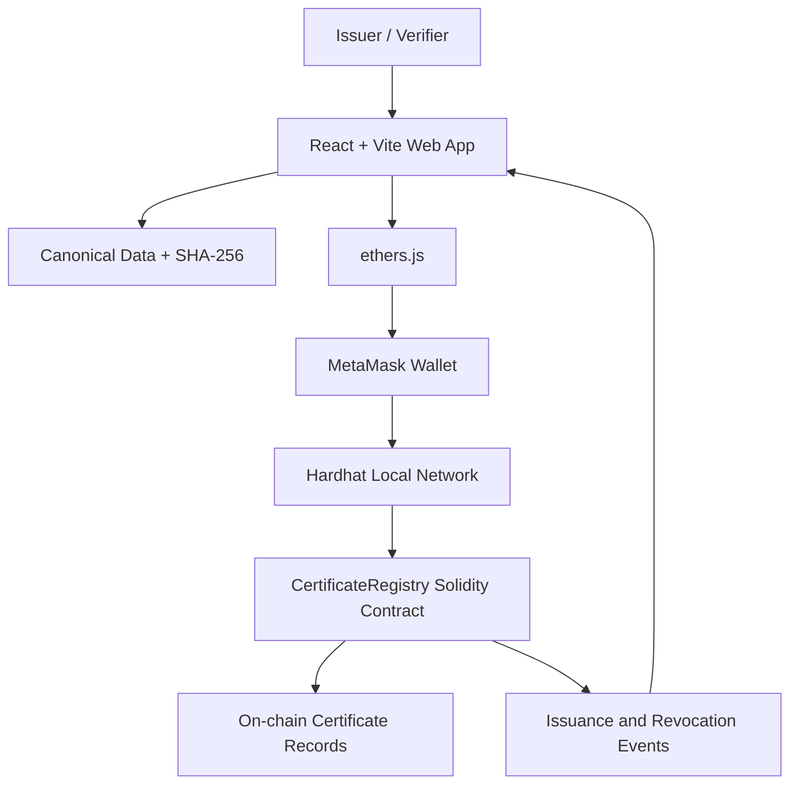

# CertiChain

CertiChain is a college prototype for checking academic certificates against a tamper-evident blockchain registry. An authorized issuer wallet stores a SHA-256 fingerprint of the certificate fields. Anyone can look up that record, compare the same fields, and see whether it has been revoked.

A successful match means the submitted details equal the fingerprint an authorized issuer recorded, and the record is not revoked. It does not prove the original information was true, and it does not make fraud impossible. The institution has to control the issuer wallet and check the data before issuing.

This is a local demo. Do not store sensitive student information on a public chain, and do not use a real wallet or real funds.

## Stack

- React, Vite, and Tailwind CSS for the interface
- Solidity and Hardhat for the local chain and contract tests
- MetaMask and ethers.js v6 for issuer transactions
- The browser Web Crypto API for SHA-256
- A QR code that opens the public verification page

There is no backend, database, or mainnet deployment in this version.

## Architecture



The issuance and verification pages import the same function in `frontend/src/lib/certificateHash.js`. It trims each field, normalizes Unicode to NFC, and hashes this JSON shape:

```json
{
  "schemaVersion": 1,
  "studentName": "Asha Mehta",
  "course": "B.Sc. Computer Science",
  "institution": "Demo University",
  "graduationYear": "2026"
}
```

The contract stores only the certificate ID, fingerprint, issuer address, timestamp, and revocation flag.

## Project layout

```text
contracts/CertificateRegistry.sol
scripts/deploy.js
scripts/issue-sample.js
test/CertificateRegistry.test.js
frontend/src
```

## Prerequisites

- Node.js 20 or newer, with npm
- A current browser
- The MetaMask extension
- Basic comfort with the terminal

This repository was set up with Hardhat 2 on the machine's installed Node version. Hardhat 2 is the line described in the project guide. If `npx hardhat compile` fails on a very new Node release, use Node 22 LTS.

## Setup

Install the contract tools from the repository root, then install the frontend:

```bash
npm install
cd frontend
npm install
cd ..
```

Compile the contract, export its ABI, and run the tests:

```bash
npm run compile
npm test
npm run test:hash
```

Start the local chain in one terminal:

```bash
npx hardhat node
```

In a second terminal, deploy the registry. The deploy script writes the address to `frontend/src/lib/deployment.json`. The first Hardhat account printed by the node is the authorized issuer, because that account sends the deployment.

```bash
npm run deploy
```

Start the website:

```bash
cd frontend
npm run dev
```

Open http://localhost:5173.

### MetaMask

Add the network the node prints. The defaults are:

| Setting | Value |
| --- | --- |
| Network name | Hardhat Local |
| RPC URL | http://127.0.0.1:8545 |
| Chain ID | 31337 |
| Currency symbol | ETH |

Import a **development account** from the private key printed by `npx hardhat node`. Use account #0 to issue and revoke. Never paste a real seed phrase or a real private key into MetaMask for this demo. The issuer portal can also ask MetaMask to switch to chain 31337.

Restarting the Hardhat node clears the chain. Deploy again and refresh the site. The UI should report that the registry cannot be reached until the new address is in place.

## Demo flow

1. Connect the issuer wallet on the Issuer Portal.
2. Choose **Fill sample record** or enter synthetic details, then issue the certificate and confirm in MetaMask.
3. Wait until the receipt is confirmed. The certificate page shows the ID, fingerprint, issuer, time, and QR code.
4. Open **Verify a Certificate**, look up the ID, and submit the same fields. The result should be **Verified**.
5. Change the course or year and verify again. The result should be **Invalid**.
6. Revoke the certificate as the issuer, then verify it again. The result must stay **Revoked**, even if the details still match.
7. Look up a random 32-byte ID. The result should be **Not Found**.

Optional sample issuance from the contract deployer, after deploy:

```bash
npm run sample
```

The command prints a verification URL for the labelled demo record (Asha Mehta, B.Sc. Computer Science, Demo University, 2026).

Generated previews are marked **DEMO / NOT AN OFFICIAL ACADEMIC DOCUMENT**.

## Contract

`CertificateRegistry` sets the deployer as the only issuer.

| Function | Access | Behavior |
| --- | --- | --- |
| `issueCertificate(id, hash)` | Issuer | Stores a new record and emits `CertificateIssued` |
| `revokeCertificate(id)` | Issuer | Marks an existing record revoked and emits `CertificateRevoked` |
| `getCertificate(id)` | Public | Returns the record, or `exists = false` |
| `verifyCertificate(id, submittedHash)` | Public | Returns existence, hash match, and revocation |
| `issuer()` | Public | Returns the authorized issuer |

The contract rejects an empty ID, an empty hash, a duplicate ID, a non-issuer, and a second revocation. There is no function that changes a fingerprint after issuance. A single issuer is enough for this prototype: there is no role transfer and no multi-college governance.

## Configuration

`npm run deploy` updates `frontend/src/lib/deployment.json`. `npm run compile` refreshes `frontend/src/lib/abi.json`.

Optional frontend overrides in `frontend/.env` (see `frontend/.env.example`):

```env
VITE_CONTRACT_ADDRESS=0xReplaceWithYourDeployedContractAddress
VITE_CHAIN_ID=31337
VITE_RPC_URL=http://127.0.0.1:8545
```

Restart Vite after changing environment variables. Only public values belong in `VITE_` variables. Do not put private keys, seed phrases, or passwords there. Set `VITE_EXPLORER_URL` only when a real block explorer exists for the network. Local Hardhat does not have one, so the UI shows the transaction hash without an explorer link.

## Tests

Contract tests cover authorization, duplicates, empty values, matching and mismatched hashes, missing IDs, and revocation. Hash tests cover canonical JSON, stable hashes, and the rule that a revoked record is never treated as verified.

### Manual test plan

| Test | Action | Expected result |
| --- | --- | --- |
| TC-01 | Connect the authorized wallet | Account and Local Hardhat Network are displayed |
| TC-02 | Issue a valid certificate | Transaction confirms and the record is saved |
| TC-03 | Issue the same ID twice | Contract rejects the duplicate |
| TC-04 | Issue from a different wallet | Contract rejects the transaction |
| TC-05 | Look up an existing ID | Public record details are returned |
| TC-06 | Submit the same canonical fields | Hash matches and the status is Verified |
| TC-07 | Change one field | Status is Invalid |
| TC-08 | Look up a random ID | Not Found |
| TC-09 | Revoke an existing certificate | Transaction confirms and the status is Revoked |
| TC-10 | Verify a revoked certificate | Never shown as Verified |
| TC-11 | Reject the MetaMask prompt | The page stays usable and explains the rejection |
| TC-12 | Connect the wrong network | A network warning appears and transactions stay blocked |
| TC-13 | Open the QR or copied link | Verification page opens with the ID filled in |
| TC-14 | Restart the local node | The UI reports that the deployment is unavailable until you deploy again |

## Troubleshooting

**Wrong network.** Confirm the Hardhat node is running, then switch MetaMask to RPC `http://127.0.0.1:8545` and chain ID `31337`. Deploy to that same network.

**Contract calls fail.** Check that `deployment.json` matches the latest deploy. A node restart deletes the contract. Deploy again.

**A legitimate certificate shows Invalid.** Both pages must use `certificateHash.js`. Extra spaces are trimmed, but letter case and field values must match exactly.

**The page says success too early.** The issue and revoke actions wait for the transaction receipt before opening the certificate page or refreshing the list.

**The QR code fails on a phone.** `localhost` points at the phone, not your computer. Use a reachable address or present the demo on the same machine.

## Future work

Multiple institutions, encrypted off-chain documents, indexed history, issuer identity checks, and a public testnet are possible later. They are not required for this demo.

## Project description

CertiChain is a blockchain-based academic certificate verification system that enables an authorized issuer to register certificate fingerprints on an Ethereum-compatible blockchain. The smart contract keeps a tamper-evident issuance and revocation record, and a verifier can compare submitted certificate data with that fingerprint. The web interface covers issuance, QR lookup, verification status, and transaction details. Present it as a college prototype, not as a replacement for official university verification.
